# CyberDome for NAM - features

CyberDome is an AI-first layer above NAM's security tools: Forcepoint DLP (data protection), Silverfort (identity),
Trend Micro (endpoint), Trellix ePO (disk encryption) and the AD / CMDB export (the device and people baseline), with
Arcon, Cloudflare and NAM's SIEM and SOAR to follow. It shows which devices miss a control and which tools are
unhealthy, triages DLP incidents with an AI whose authority is earned, joins one person's signals from several tools
into one case, scores the posture with a published formula the CISO agrees, maps evidence to SEBI CSCRF, DPDP and
CERT-In, and measures the pilot against its baseline.

Every screenshot below was captured from the running system (API + console in Chrome, NAM scope) by the NAM browser
tour, after loading the sample estate through the API: a fictional organisation (`acme-demo.com`) with vendor-shaped
data for the five tools. Nothing is mocked; every figure is computed by the platform. The model was off, so the
written text is the platform's own (equally cited). **All figures shown are sample data** - none is a measurement of
NAM's estate.

**Contents**

1. [The console and the platform essentials](#1-the-console-and-the-platform-essentials)
2. [Dome Connect: tools, tool health and changes](#2-dome-connect-tools-tool-health-and-changes)
3. [Dome Graph: control coverage](#3-dome-graph-control-coverage)
4. [Dome Agents: data protection](#4-dome-agents-data-protection)
5. [Cross-tool cases](#5-cross-tool-cases)
6. [Dome Score and the CISO view](#6-dome-score-and-the-ciso-view)
7. [Dome Comply](#7-dome-comply)
8. [Pilot scorecard and value scorecard](#8-pilot-scorecard-and-value-scorecard)
9. [Reports](#9-reports)
10. [Works on any organisation](#10-works-on-any-organisation)
11. [How it was verified](#11-how-it-was-verified)
12. [Not built yet](#12-not-built-yet)

---

## 1. The console and the platform essentials

### 1.1 The console

One web console, light by default with a one-click dark theme (remembered per browser). The menu is grouped by job:

| Group | Screens |
|---|---|
| Operate | Dome Score (the home screen of an all-domain user), Pilot scorecard, Intelligence, Cases, Approvals |
| Domains | Data protection (the home screen of a DLP-scoped analyst) |
| Insight | Dome Graph · coverage, Dome Connect · changes |
| Govern | Dome Comply, Watch lists, Tuning, Integrations, Automation policy, AI usage, Reports, Access, Audit log |

* **Only what NAM asked for.** With `SOC_PRODUCT_SCOPE=nam` (the build's default) the inherited screens - overview,
  phishing, vulnerabilities, cloud posture, ATT&CK coverage, shadow IT, supplier risk - are not shown, their routes
  answer 404 and their jobs do not run. Filters follow too: the Cases screen offers only the scope's domains.
* **The menu folds** to a rail of icons (names on hover) with the button at its top right and opens the same way;
  the choice is remembered; it works from the keyboard and tells screen readers its state. On a phone it starts folded.
* **The top bar** shows the kill switch state, the signed-in person, role and MFA, and a search box over cases,
  people, devices, indicators and findings - only what the person's role and data scope allow.
* **Every page has a stable URL** (`#/cases/<id>`, `#/entity/<id>`), so links can be shared and back works.
* **Design:** strict Content-Security-Policy (no inline script, no third-party resources), every value escaped,
  buttons a person cannot use hidden (the server enforces the same rules), a slow page never paints over the next
  one, accessible focus states and contrast (WCAG 2.1 A/AA checked by axe-core on every screen, both themes),
  layout checked at 1440, 1280, 1024, 768 and 390 px.

Sign-in: the demo uses a development form (person, role, data scope). In production (`SOC_AUTH_MODE=entra`) the
same screen shows *Sign in with Microsoft*: Entra ID single sign-on with MFA and roles from the platform's app roles
([DEPLOYMENT_GUIDE.md](DEPLOYMENT_GUIDE.md) section 4).

| Sign-in | Dome Score (home) | Phone, menu folded |
|---|---|---|
| 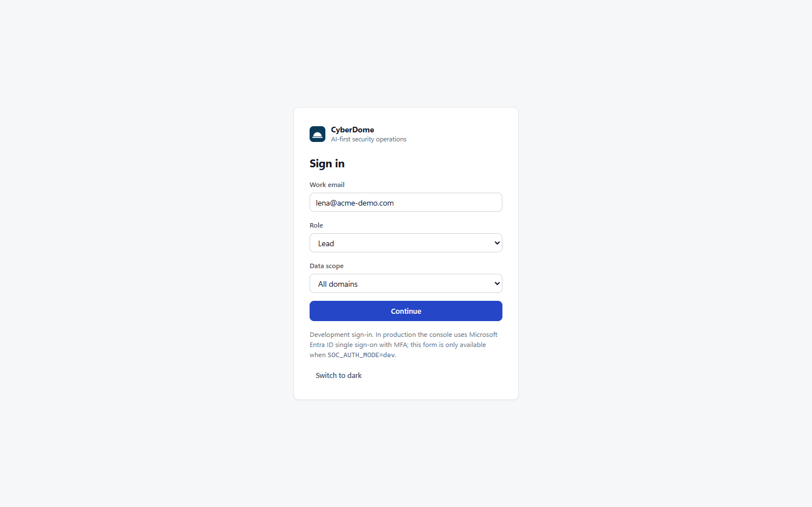 | 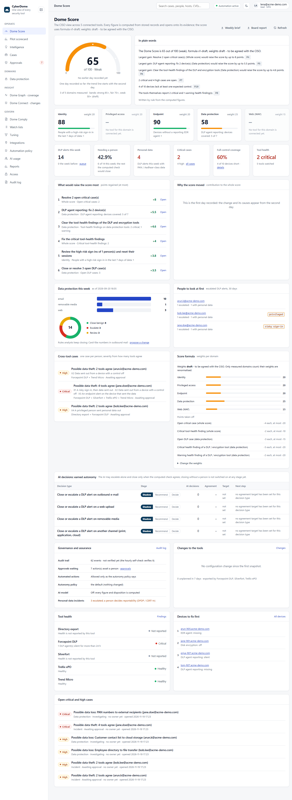 | 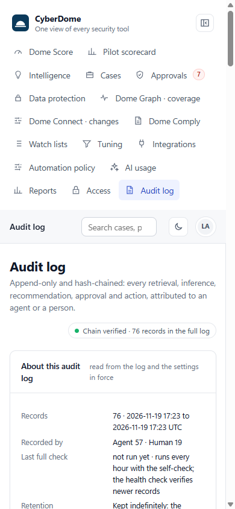 |

### 1.2 One record per device and per person

Every tool feeds one canonical model: records → entities (devices, people, indicators) + events (DLP incidents,
risky sign-ins, endpoint alerts, health reports) + relations, each with its source and a link into the tool.

* **Devices** resolve across the directory export, Forcepoint (agent), Trend Micro (agent) and Trellix (encryption)
  by deterministic keys (vendor ids, serial, MAC, FQDN) before scored hints (host name, address in a time window,
  OS); an uncertain match waits for an analyst, never merged by guess. The sample estate's laptop seen by four tools
  is one record (`test_connector_nam_stack.py`).
* **People** resolve by UPN / e-mail / SAM / aliases; built-in and machine accounts never become people; a record
  claiming another person's address is queued, never merged.
* **Entity page** per person or device: identifiers from every tool, explainable risk, cases, related people and
  devices, one timeline across tools.

### 1.3 Cases, evidence and teamwork

Every investigation is a case: a plain-language assessment, facts separated from inferences, each claim citing
numbered evidence (hover a reference to see the tool, time and text; click to jump), the tools that agree, the
recommended actions, the entities, one timeline and the case's audit trail. *Take case* assigns it; a lead can give it
to someone else; the list filters *Mine* / *Unassigned*. **Analyst notes** are kept permanently and never edited.
The model's written explanation arrives seconds after the case (the case says so meanwhile); nothing it writes
changes a decision.

| Cases | A data-protection case | A cross-tool case |
|---|---|---|
| 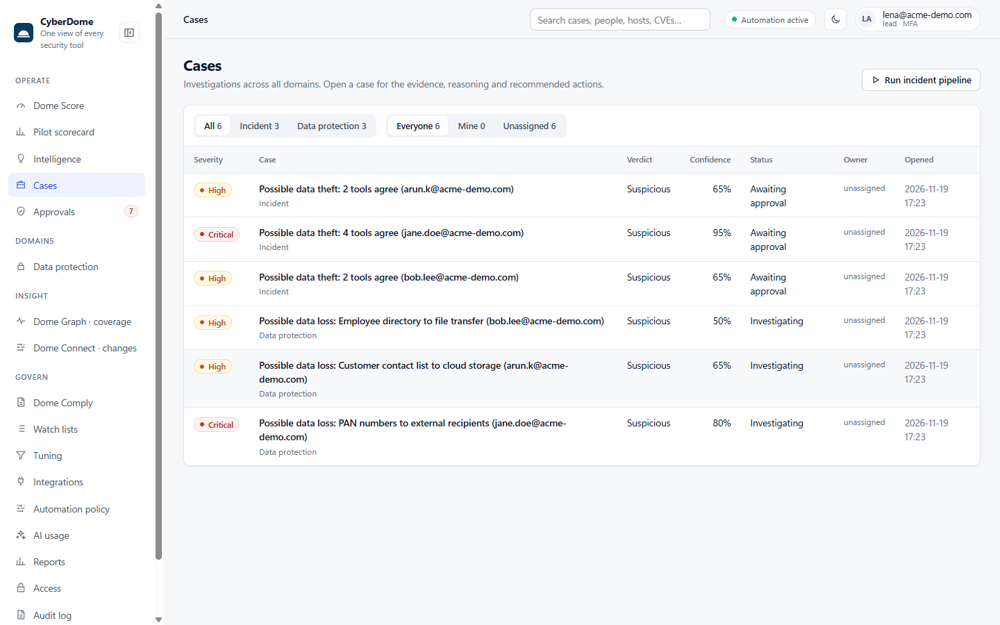 | 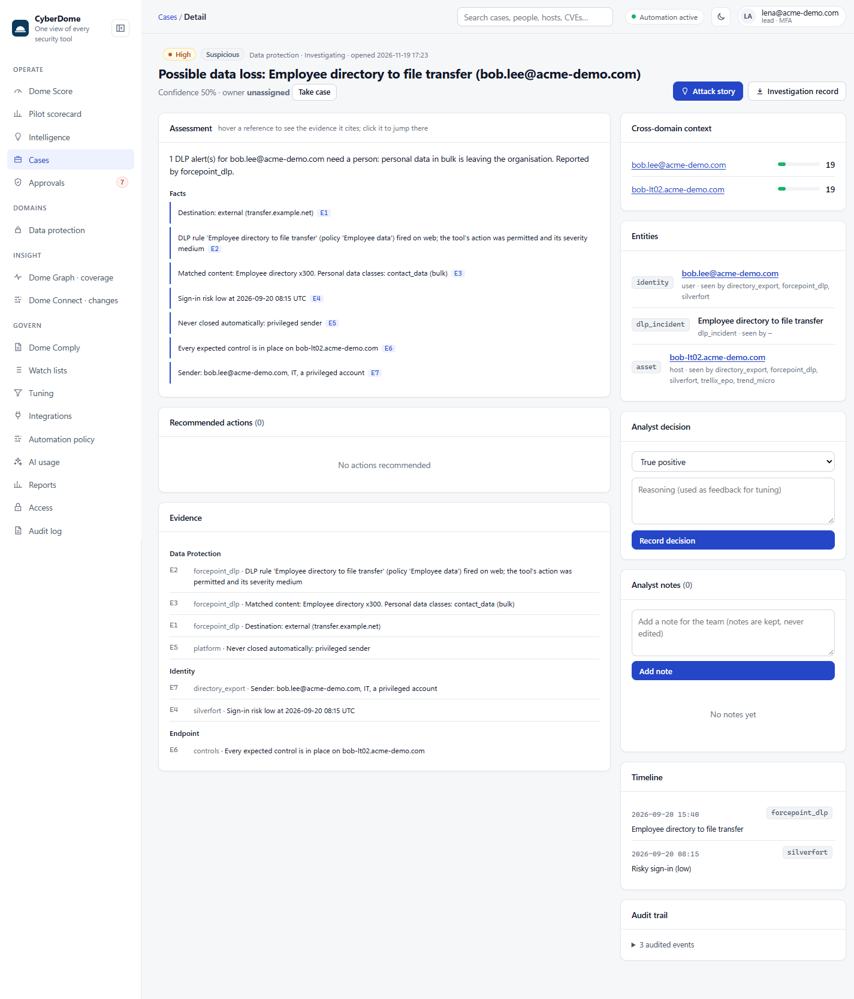 | 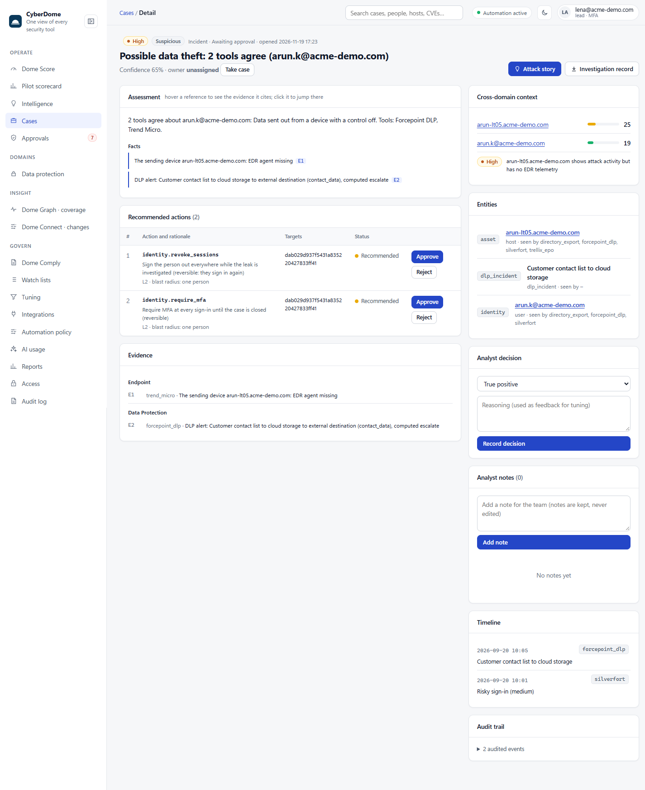 |

### 1.4 Governed actions

* **Autonomy levels L0-L4 per action type**; the default for every action is **L2: the platform recommends, a person
  decides**. A tool at stage `recommend` caps its actions at L2 whatever the policy says.
* **Containment is decided by people, four-eyes, always**: isolating a device, disabling an account, resetting a
  password, confirming a compromise, rotating a privileged secret. The engine holds this whatever a policy document
  says; a document that tries is refused.
* **Gates:** destructive actions never autonomous; VIP / critical targets and blast radius force approval; hard
  limits block; four-eyes needs two different people.
* **One execution path:** every write to a tool is an action request through the policy; pre-conditions re-checked
  at execution; idempotency keys; reverse actions; a call whose result never came back is flagged "verify in the
  tool", never repeated.
* **Kill switch** - durable, every replica, immediate; switching it off needs a lead.
* **Approvals carry their context:** what the action was raised on, the evidence it cites, what the tool will be
  asked to do, reversible or not, blast radius, policy reasons.

| Approvals | Automation policy |
|---|---|
| 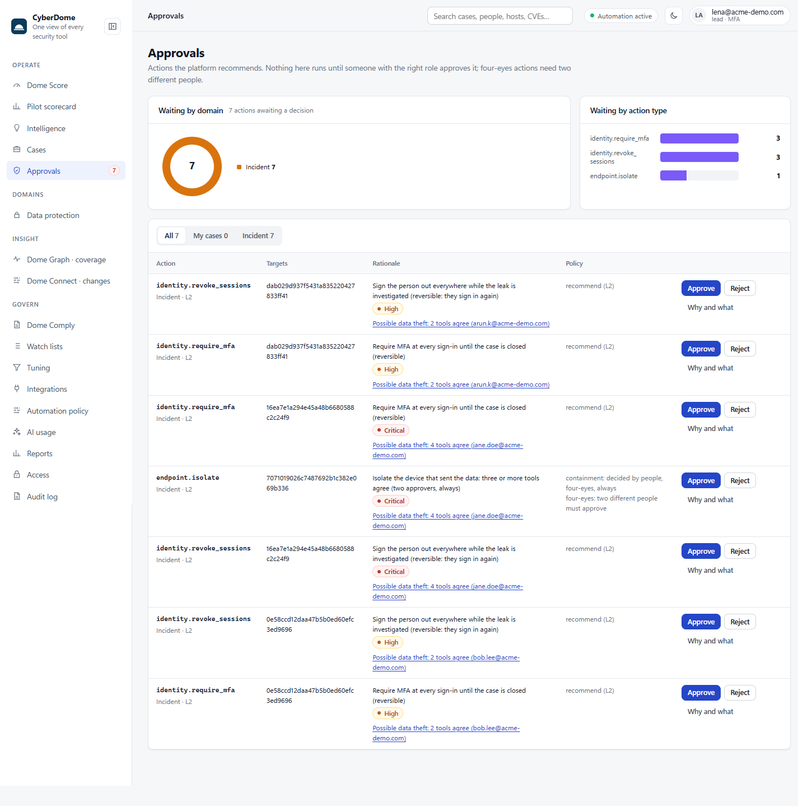 | 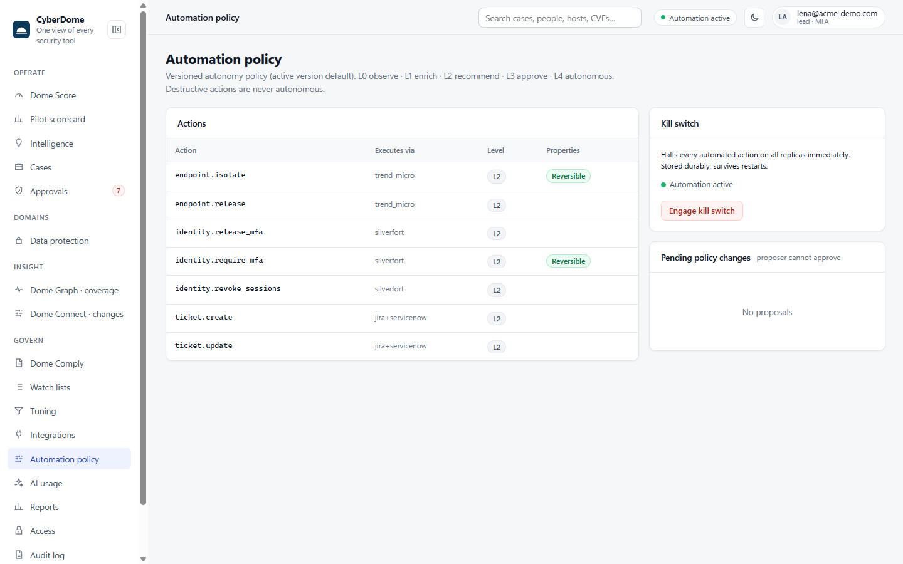 |

### 1.5 Access, audit and the AI's limits

* **Authentication:** Entra ID (RS256 via tenant JWKS; an application's own token is a service account); dev tokens
  only in dev and never with a live tool; service-account API keys (hashed, ≤ 365 days, never approve); sealed
  break-glass (15-minute session, audited and alerted).
* **Authorisation:** roles (analyst, lead, admin, automation admin, auditor) + **data scope** (`dlp`, `incident`, or
  all domains; the Dome Score, Comply and Pilot screens need all domains) + **step-up MFA** for every decision +
  separation of duties (no self-approval anywhere). Each role acts only inside its own scope.
* **Audit:** append-only, hash-chained, refused by the database as well as the application, verified hourly and
  anchored in the log pipeline. *Audit log* screen: the facts about the log, export in JSON Lines, JSON, CSV, Excel or
  Word (re-verifiable outside the platform), every export audited. Every request and job has a trace id; *Trace*
  shows everything one request did, each model call included.
* **AI usage & limits** (*Govern -> AI usage*): monthly and daily budgets, per-person limits, per-feature model by
  name, longest answer and on / off - versioned and audited. Use and cost per feature and person. Over a limit the
  platform answers without the model and says why.

| Access | Audit log | AI usage |
|---|---|---|
| 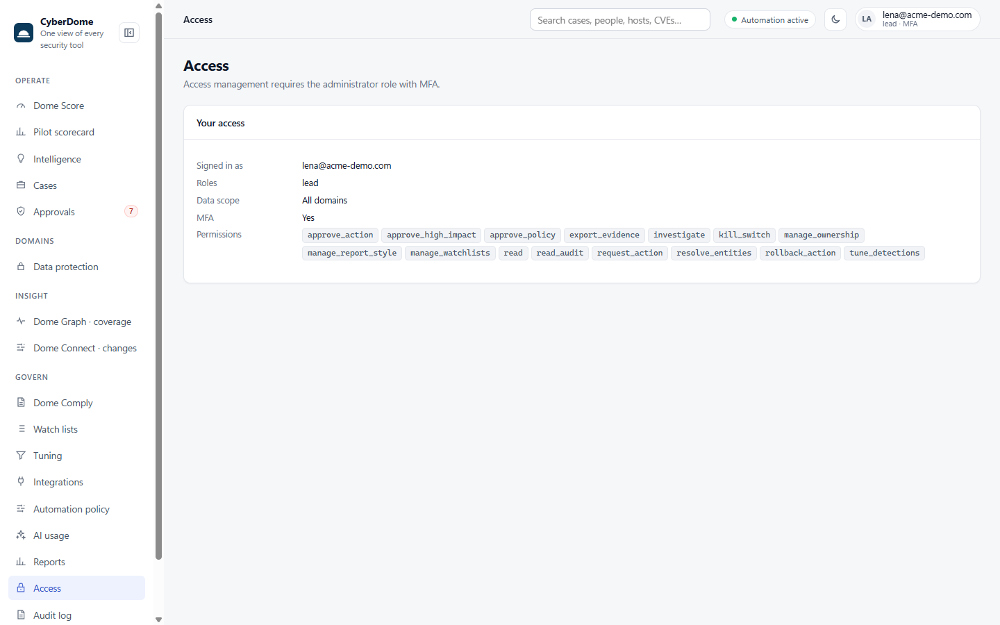 | 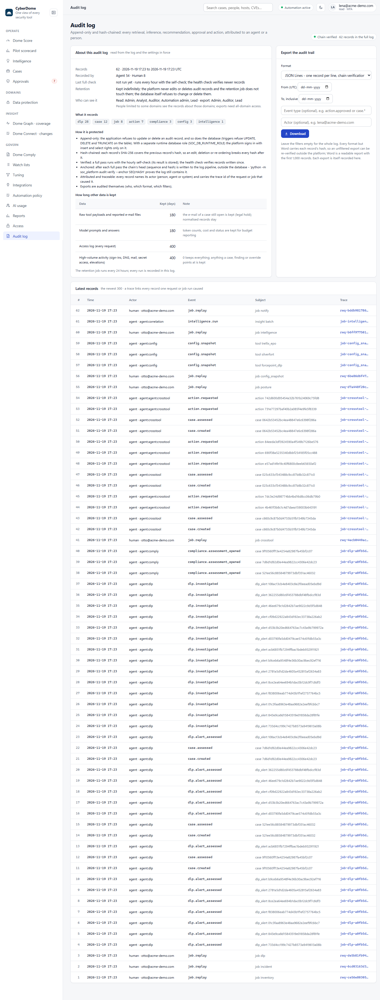 | 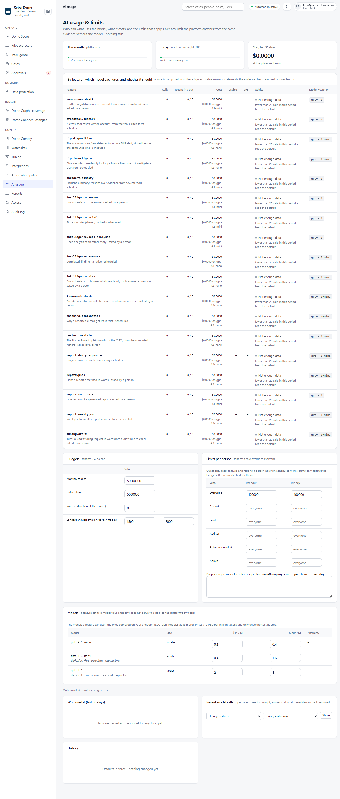 |

### 1.6 Watch lists, tuning, notifications

* **Block and exception lists** (*Govern -> Watch lists*): a lead uploads an Excel or CSV list of users, devices,
  addresses, domains, URLs, hashes; preview first; every case involving a listed item says so. A person or device on
  the **block** list is on the DLP never-automatic list. A match never changes a severity or decision by itself.
* **Tuning** (*Govern -> Tuning*) of the incident workflow (the SIEM's alerts): suppress a noisy detection, set the
  noise threshold, raise attention on hosts or people, label an exercise, mark an action as usually rejected - a
  draft from a fixed menu (the model may draft it from a lead's words), previewed on past data, approved by a second
  lead; high / critical and deception alerts are never suppressed and 1 in 10 suppressed incidents stays open. DLP
  rule changes have their own lifecycle (section 4.4).
* **Notifications:** findings above a severity to Teams, Slack or a webhook; each once per channel; failures retried.

| Watch lists | Tuning |
|---|---|
| 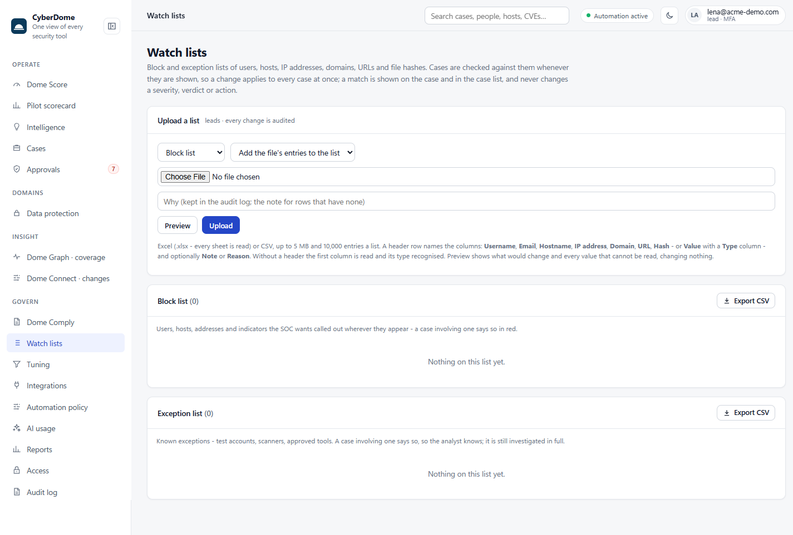 | 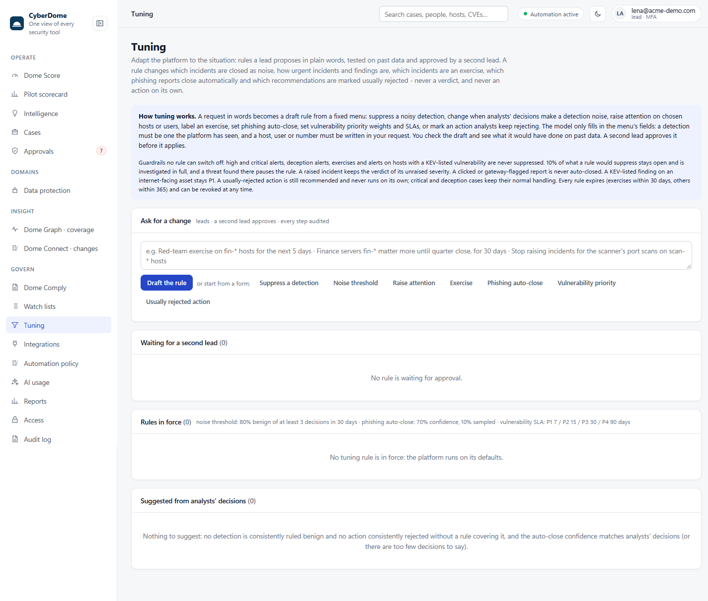 |

---

## 2. Dome Connect: tools, tool health and changes

### 2.1 Connecting NAM's tools

| Tool | Role | What is read | Actions (all through approval) | State |
|---|---|---|---|---|
| Directory / CMDB export | baseline | devices, people, DLP policy-group membership | none | fake mode |
| Forcepoint DLP | data protection | incidents, agent check-ins, health (certificates, jobs, directory import), rule configuration | none - rule changes are made by an engineer | fake mode |
| Silverfort | identity | risky authentications, policy configuration | revoke sessions, require MFA (reversible) | fake mode |
| Trend Micro | endpoint | agents (inventory and check-ins), alerts | isolate / release a device (four-eyes) | fake mode |
| Trellix ePO | disk encryption | devices and encryption state, health, policy configuration | none | fake mode |
| SIEM (product unknown) | logs | alerts pushed to the generic webhook | none | generic webhook |
| ServiceNow / Jira | tickets | tickets | create / update a ticket | inherited |

"Fake mode" means vendor-shaped sample data through the same parsing code a live tool uses. The endpoint paths and
response shapes of the five NAM connectors are **placeholders** until each tool's version and licensed API are
confirmed against its documentation; every path is a setting, and `preflight` lists what is still to confirm. Tools
are switched on, configured, previewed (*Preflight*) and approved on *Integrations*; each moves through stages
fixtures → recording → read-only → recommend → automate, one approved step at a time; *Pause* stops one at once.

| Integrations |
|---|
| 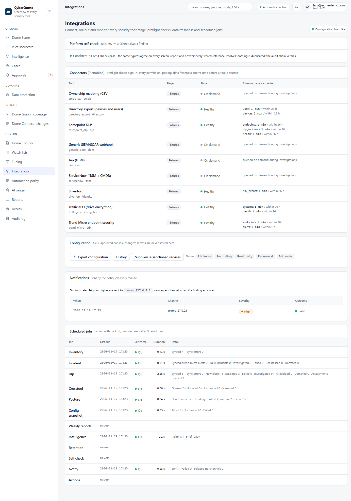 |

### 2.2 Tool health

Findings from what each tool reports about itself - wherever it reports it, shown as a capability matrix:

| Finding | Measured from |
|---|---|
| Agents silent for more than 24 h | the newest check-in the tool reported for any device (never the wall clock) |
| Failed or late sync and deployment jobs | each job's own interval and last run, as the tool reports them |
| Certificate days left (warning ≤ 30, critical ≤ 14, expired) | the tool's own newest report |
| People left out of every DLP policy group by the directory import | the import's report |
| Configuration changed outside a recorded change | the configuration snapshots (2.3) |

Each finding names the next step (a ticket, an agent re-push). A tool that reports none of this is "not reported" -
never "healthy". The Dome Score's tool-health penalties read these findings.

### 2.3 Configuration snapshots and changes

| Feature | What it does |
|---|---|
| Where the tool can export it | Forcepoint rules, Silverfort policies and Trellix policies read in full daily; a snapshot kept only when something changed; other tools shown as "not exported" |
| Recorded changes | *Before change* (with the change's reference) → the change in the tool → *After change*: the difference field by field and the Dome Score before and after |
| Unplanned changes | A difference outside a recorded change shows on tool health for 7 days |

| Dome Connect · changes |
|---|
| 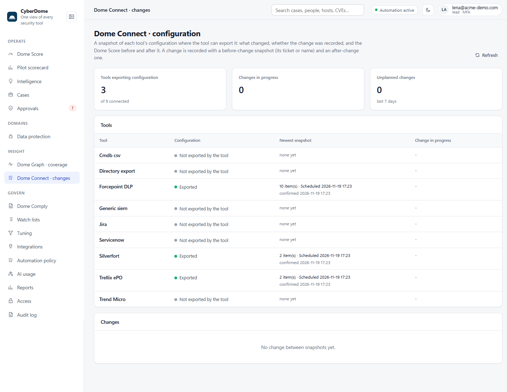 |

---

## 3. Dome Graph: control coverage

| Feature | What it does |
|---|---|
| Coverage against the baseline | Every device of the directory export checked against each control that applies to it: EDR agent (every device), DLP agent reporting and disk encryption (workstations). Covered = every expected control in place and reporting |
| Four kinds of gap | missing (the tool does not list the device), silent (its agent stopped reporting), off (encryption not in force), unknown (the tool says nothing) |
| Not in the baseline | devices a tool sees that the directory does not list, reported separately |
| Not measured | a control whose tool is not connected is "not measured" - never "missing everywhere" |
| Riskiest first | devices short of a control ranked by the personal-data DLP alerts on them and their main user (that figure only within DLP scope) |
| Users in no DLP policy group | from the directory's group membership |
| A tool that stops listing a device | stops counting as covering it once its newest full read is older than 48 h past the device's last listing |

| Dome Graph · coverage |
|---|
| 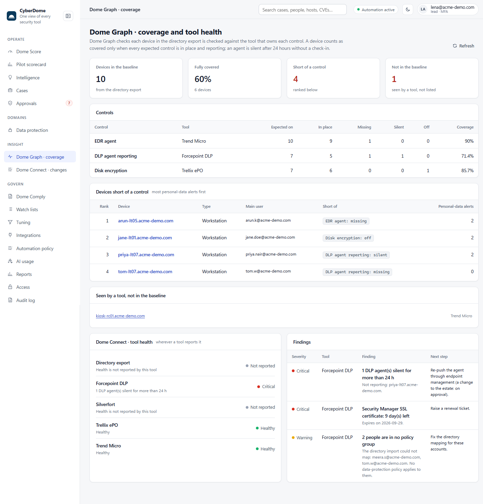 |

---

## 4. Dome Agents: data protection

### 4.1 DLP triage

| Feature | What it does |
|---|---|
| One alert per incident | each Forcepoint incident becomes one alert, linked to its sender and device; re-reading changes nothing |
| Judged on numbered facts | F1, F2 ...: the rule and what matched (classifier, matches, type, read from an image or not), personal-data classes (PAN, Aadhaar, investor account numbers...), the destination (internal, partner, sanctioned service, personal mail, removable media, external, unknown), the sender (privileged or not), a risky sign-in within 24 h, the device's missing controls |
| Computed disposition | a published decision table: escalate, close as benign, or needs a person, with the rule that fired. Severity is the tool's, raised only for bulk personal data leaving and when other tools corroborate. No model takes part |
| Cases | an escalation opens one data-protection case per sender and day with every fact cited, the tools that agree, the personal-data classes and the next steps |
| Never automatic | high / critical alerts, privileged senders, the block list, a device with a known-exploited flaw, deception hits |
| The sender's text is data | subject and file names shown to the analyst and to the model fenced, as data; no rule reads them - a message saying "approved transfer" changes nothing. A destination is kept only when it is a real host name |
| Rulings from the tool | a ruling already given in Forcepoint is carried over, so agreement can be measured from day one |

| Data protection |
|---|
| 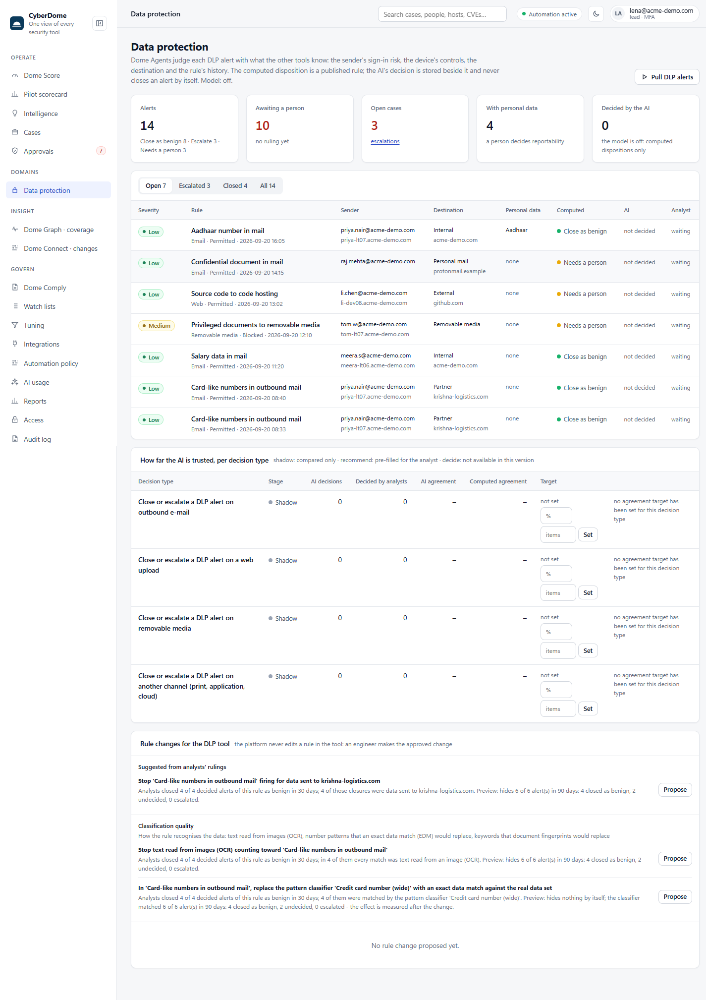 |

### 4.2 The AI investigator

Seven read-only look-ups over what the platform already holds - sign-in history, the sender's other DLP alerts, who
else sent to the destination, alerts and deception hits on the device, privileged-access events, open cases, watch
lists. The model chooses up to 5 in 2 rounds within 20 seconds; anything off the menu is dropped. Without the model
the platform runs its own standard checks. Findings are numbered I1, I2 ...; the AI's decision may cite them; the
computed disposition never reads them.

### 4.3 Earned autonomy

| Feature | What it does |
|---|---|
| Narrow decision types | `dlp.email`, `dlp.web`, `dlp.removable_media`, `dlp.other` - each climbs on its own |
| The AI's own decision | close or escalate from the numbered facts, citing them; one that cites nothing or names no valid outcome is discarded |
| Stored to be replayed | decision type, stage, model, prompt version, a hash of the facts, outcome, cited reasons, the computed outcome and the analyst's |
| Shadow, then recommend | shadow: compared only. Recommend: pre-filled for the analyst; overruling needs a reason. **Decide is refused in code** in this version |
| Promotion is earned | the SOC lead sets an agreement target and minimum sample (no default); a promotion is refused until met, proposed by one lead, approved by another, measured again at approval |
| Demotion needs nobody | agreement below target, or the AI's outcome mix shifting, sends a type back down on the next run |
| Two guards on closing | the AI may escalate alone; a close counts only when the computed disposition agrees and the alert is not on the never-automatic list |
| Works without the model | off, over budget or failing: no AI decision stored, every disposition, severity and count identical |
| Re-checks | 1 in 10 AI closures is re-checked by a person, permanently |

### 4.4 Rule changes for the DLP tool

| Feature | What it does |
|---|---|
| Suggested from rulings | a rule analysts close as benign four times in five gets a suggestion: exclude the destination the closures share, or raise the match threshold above every closed alert |
| Classification quality | from each classifier's type and whether its matches were read from an image: **stop OCR counting** toward a rule whose closures were all scanned images; **replace a pattern classifier with an exact data match (EDM)** against the real data set; **replace a keyword classifier with document fingerprints** |
| Preview | what the change would have hidden in 90 days and how analysts ruled on those; an EDM or fingerprint change hides nothing by itself - its preview shows the alerts the classifier matched, warns when some were escalated, and its effect is measured after the change |
| Refused when unsafe | hiding an escalated alert, bulk personal data, a high / critical alert, a never-automatic alert - or nothing - is refused at proposal and approval |
| Two leads, one engineer | a lead proposes, a second approves, an engineer records the change made in Forcepoint. The platform never edits the tool |
| Did it take effect? | the configuration snapshot is checked (exclusion listed, threshold, OCR off, the old classifier gone and an EDM / fingerprint one present) and the alerts it should have stopped are counted |

---

## 5. Cross-tool cases

| Feature | What it does |
|---|---|
| One person, one case | a DLP leak joined with a risky sign-in (X1), a control off on the sending device (X2), an endpoint alert on it (X3), or a privileged person sending personal data (X4) becomes one case per person; each tool's facts cited |
| Severity from agreement | two tools agreeing → high; three or more → critical ("4 tools agree"); one tool alone → no case |
| Facts, not text | message text never creates or changes a case |
| Actions behind approval | revoke sessions and require MFA recommended (reversible); isolating the device only when three or more tools agree, and always by two people |
| Re-runs change nothing | a new signal joins the open case; nothing is duplicated |

---

## 6. Dome Score and the CISO view

| Feature | What it does |
|---|---|
| One score, published formula | five domains (identity, privileged access, endpoint, data protection, web) scored from coverage, tool health, risky sign-ins and open cases; a weighted mean less penalties for open critical cases and critical health findings |
| Not measured is not zero | a domain no connected tool measures (privileged access and web until Arcon and Cloudflare) is "not measured" and left out |
| Recomputable | every response carries the factors and their effect in points |
| Adjustable weights | a lead sets each domain's weight (0 leaves it out) and the penalties, previews the score, proposes with a reason; a **second lead** approves; until then the draft applies and every surface says so |
| What would raise it most | every reduction with the points the score would regain and the screen where it is fixed |
| Why it moved | today against the oldest stored day of 30, per domain, naming a change of weights when there was one |
| The CISO view | gauge, band and 30-day trend; domain tiles; levers; movement; the DLP week and people to look at first; the AI ladder per decision type; cross-tool cases; governance (audit chain, approvals, kill switch, policy, the model's use); changes to the tools; tool health; devices to fix first - each figure the same as on its own screen |
| In plain words | a brief written by rule from the computed figures; on request the AI writes it, every statement cited |

| Dome Score | Weights agreed |
|---|---|
|  | 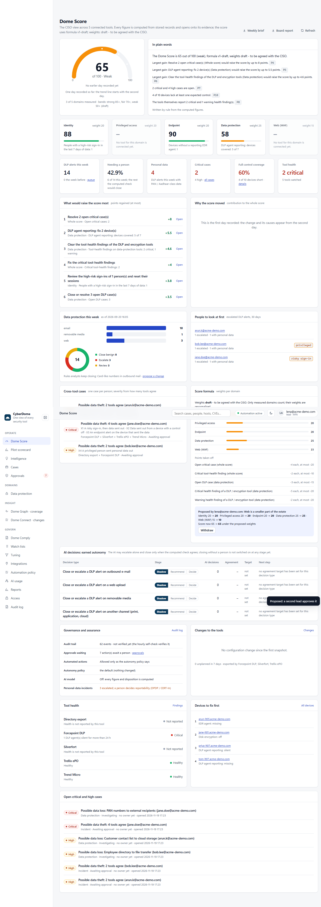 |

---

## 7. Dome Comply

| Feature | What it does |
|---|---|
| Evidence per control | SEBI CSCRF, DPDP and CERT-In control areas, each mapped to tests the platform computes (11 NAM tests and the platform's own): pass, fail or no evidence; the share with current evidence and the gaps named. **Never "compliant"** |
| Catalogue as data | a DRAFT catalogue for NAM's compliance team to validate or replace; changes need two people |
| Reportability | every DLP case with personal data opens an assessment; a lead decides reportable or not, in person, with a reason; the decision stands |
| Deadlines | clocks from the catalogue, each with its source and "to verify" until checked; a clock without hours shows "deadline not set" |
| The draft | the AI drafts the report from the case's structured facts, every sentence cited (or by rule without the model); a person reviews and sends it - the platform sends nothing - and records each submission with its reference |
| Log retention | 180-day log retention checked per tool, as far as each tool reports it |
| Audit pack | one zip: controls and evidence (JSON, CSV), assessments, the catalogue, the full audit trail, a Word summary |

| Dome Comply | A reportability decision |
|---|---|
| 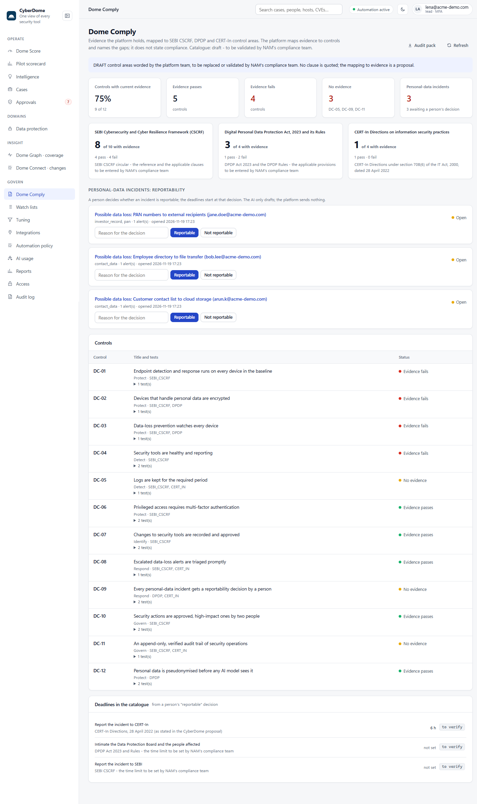 | 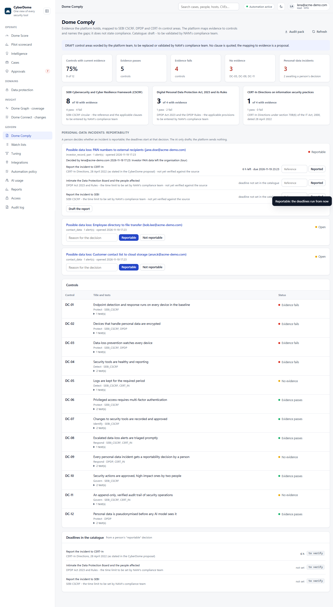 |

---

## 8. Pilot scorecard and value scorecard

**Pilot scorecard** (*Operate -> Pilot scorecard*):

| KPI | Measured as |
|---|---|
| DLP alerts reaching an analyst | alerts needing a person, over the 7 days up to the newest alert |
| Alerts per day | the same week |
| Outages found by users first | the outage log (tool, who found it first, when) |
| The model's share and cost per alert | AI-decided alerts and model cost over the week |
| AI agreement per decision type | from `ai_decisions` against analysts' rulings; QA re-checks reported apart |

The week-2 value becomes the baseline in one click; targets are set by the SOC lead - **none is preset**. Each KPI
shows met, improving, not improved, no baseline, no target or no data.

| Pilot scorecard | Baseline captured |
|---|---|
| 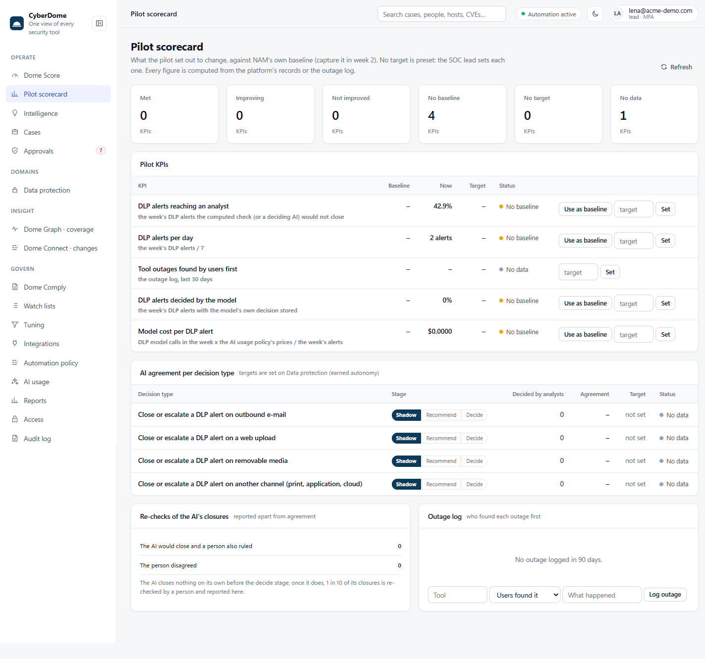 | 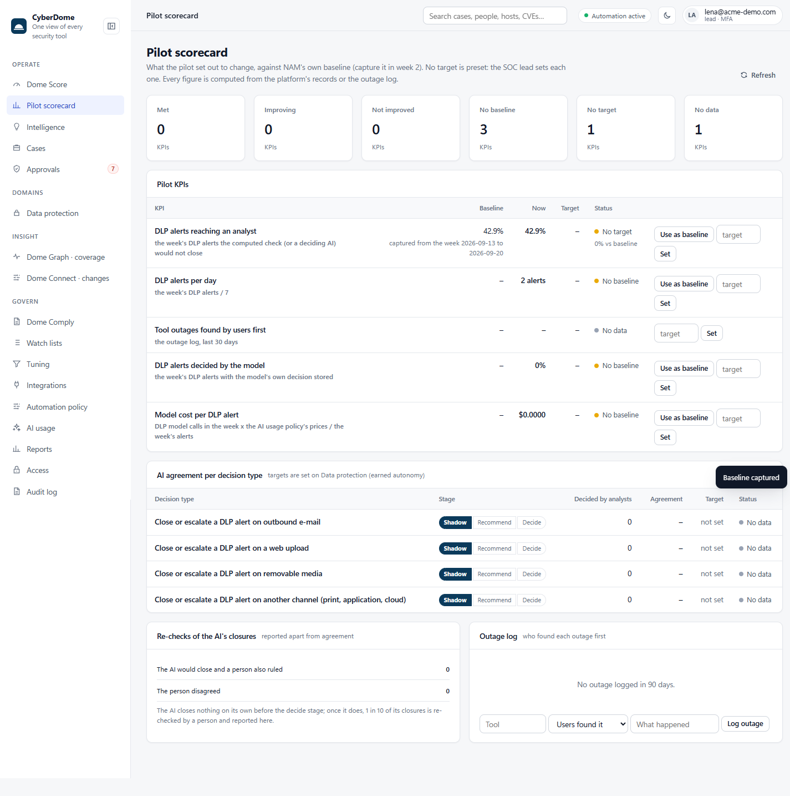 |

**Value scorecard** (`GET /api/v1/value/scorecard`): the platform core's benefit KPIs against baselines a lead records
(with their source); kept for the board pack.

---

## 9. Reports

* **CyberDome board report (monthly, PowerPoint)** and **CISO weekly brief (Word)** - built from the CISO view's
  document, so every figure equals the screen's; one click from the Dome Score screen; the weekly brief is also
  scheduled.
* **Report builder:** a report described in words is planned from the NAM sections only (posture, coverage, tool
  health, data protection, AI autonomy, configuration changes, governance); figures come from code, narrative must
  cite them.
* **The organisation's style:** Word / PowerPoint templates, logo, brand colours, a writing guide - versioned,
  hardened uploads.

| Reports |
|---|
| 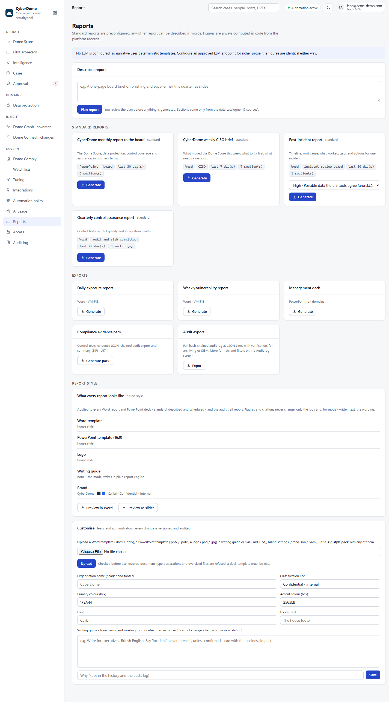 |

---

## 10. Works on any organisation

`scripts/build_estate_variant.py` generates other organisations (names, devices, addresses, volumes, a messy
variant) with the NAM tools' fixtures; the DLP pipeline, cross-tool rules and coverage run on every estate in the
suite (`ESTATES`), and no name of the sample estate leaks into another's output. An Indian asset-manager sample estate
(fund operations, investor database, Indian names) is not built yet.

## 11. How it was verified

* The test suite runs on SQLite and PostgreSQL ([TEST_REPORT.md](TEST_REPORT.md) has the current counts); each
  feature above is mapped to the tests that prove it in [FEATURE_VERIFICATION.md](FEATURE_VERIFICATION.md)
  (`python scripts/verify_features.py`).
* The NAM browser tour (`scripts/ui_tour/tour_nam.js`) drives every screen in a real browser, cross-checks every
  KPI against the API, drives the weights, reportability and baseline flows, probes stored XSS through every field a
  person writes, signs in as a DLP-only analyst, and audits layout and accessibility at five widths in both themes.
* `test_pentest_nam.py` attacks the NAM surface ([SECURITY.md](SECURITY.md) section 4).

## 12. Not built yet

Connectors for Arcon (privileged access), Cloudflare (WAF), NAM's SIEM and SOAR products · live, tenant-verified
versions of the five connectors and their action calls · privileged-access check-outs in the cross-tool rules ·
execution through NAM's SOAR (M9) · the decide stage · NAM's own control list and confirmed regulatory deadlines
(only CERT-In's 6 hours is in the catalogue, marked "to verify") · the Indian asset-manager sample estate.
