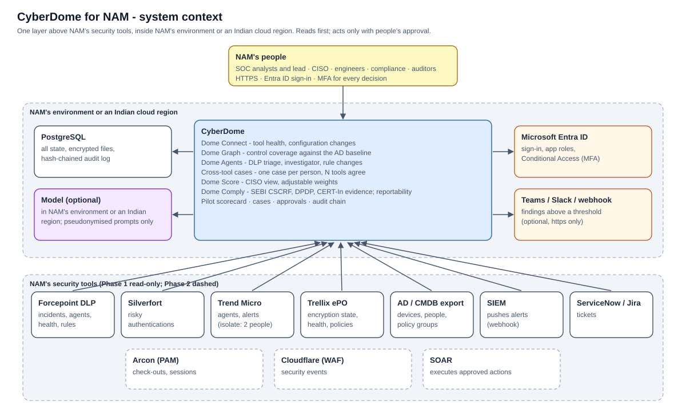
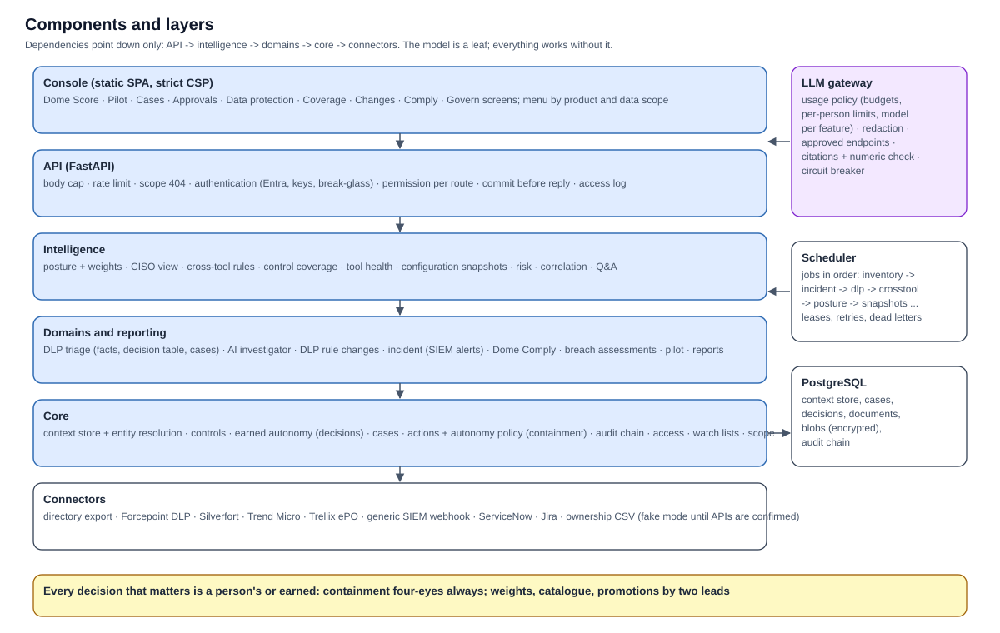
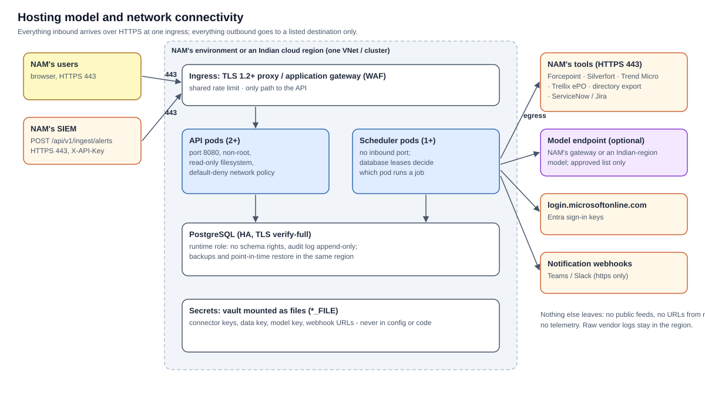

# 1. Solution architecture

| | |
|---|---|
| **Document** | CyberDome for NAM - review pack, document 1 of 9 |
| **Answers** | What runs where; the system context and components; the hosting model; infrastructure; network connectivity |

## 1.1 Purpose and principles

CyberDome is one investigation, coverage and governance layer above NAM's security tools. Five principles shape the
architecture:

1. **Inside NAM's boundary.** The platform, its database and backups, and the AI model (when used) run in NAM's
   environment or an Indian cloud region. No SaaS component; no data leaves except to NAM's own tools, an approved
   model endpoint, and notification channels NAM configures.
2. **Read first, act later.** In Phases 1-2 every tool is read-only; actions are recommended and approved by people;
   containment always needs two people.
3. **Computed, then explained.** Every figure, score and severity is computed in code; the AI investigates,
   explains and - only as far as each decision type has earned - decides DLP dispositions.
4. **Facts, not text.** Decisions read structured facts; text an insider can write is never decisional.
5. **Everything on record.** Every decision by a person or the AI is in a hash-chained audit log.

## 1.2 System context

| Actor / system | Interaction | Status |
|---|---|---|
| NAM's people (SOC analysts and lead, CISO, engineers, compliance, auditors) | the web console over HTTPS; Entra ID sign-in; MFA for decisions | Implemented (Entra: Configured at deployment) |
| Forcepoint DLP, Silverfort, Trend Micro, Trellix ePO, AD / CMDB export | read over each tool's API (HTTPS); Silverfort and Trend Micro actions only after approval, from Phase 3 | Implemented in fake mode; To validate in NAM's environment |
| NAM's SIEM | pushes alerts to the platform's webhook | Implemented (generic); product connector Not built |
| ServiceNow / Jira | tickets (create / update, after approval) | Implemented |
| Arcon, Cloudflare, SOAR | Phase 2-3 | Not built |
| AI model | optional; NAM's own gateway or an Indian-region model; pseudonymised prompts | Implemented; Configured at deployment |
| Teams / Slack / webhook | findings above a severity threshold | Implemented; Configured at deployment |

## 1.3 Components and layers

| Layer | Components | What they do |
|---|---|---|
| Console | single-page web app | the screens: Dome Score (CISO view), Pilot scorecard, Cases, Approvals, Data protection, Coverage, Changes, Dome Comply, and the governance screens |
| API | FastAPI application | authentication, authorisation per route and data scope, input limits, audit of every write, commit before reply |
| Intelligence | posture (Dome Score), CISO view, cross-tool rules, control coverage, tool health, configuration snapshots, risk, correlation | everything that joins tools; every figure computed |
| Domains and reporting | DLP triage, AI investigator, DLP rule changes, incident (SIEM alerts), Dome Comply, breach assessments, pilot, reports | the workflows |
| Core | context store and entity resolution, controls, earned autonomy, cases, actions and autonomy policy, audit, access, watch lists, product scope | shared services and governance |
| Connectors | one per tool; fake mode on vendor-shaped data until each API is confirmed | reading (and, from Phase 3, approved writes) |
| Scheduler | jobs with database leases | recurring work in a fixed order: baseline first |
| LLM gateway | budgets, limits, redaction, approved endpoints, citation checks, circuit breaker | every model call; optional |

**Product scope.** The platform core this build runs on also contains modules NAM did not ask for (phishing,
vulnerability management, cloud posture and others). In NAM's deployment they are **switched off**
(`SOC_PRODUCT_SCOPE=nam`): not listed, not scheduled, their routes answer "not found", their screens are hidden, and
the inherited ML engine never loads. A test proves each of these.

## 1.4 Hosting model

| Option | What runs | Status |
|---|---|---|
| Kubernetes (recommended) | 2+ API pods, 1+ scheduler pods, PostgreSQL HA (CloudNativePG on premises, Azure Database for PostgreSQL Flexible Server zone-redundant), ingress with TLS / WAF, vault-mounted secrets | Implemented (package in `deploy/kubernetes/`, Azure and on-premises overlays); deployment Configured at deployment |
| Docker Compose | API, scheduler, PostgreSQL with TLS, optional TLS proxy and backups | Implemented (`deploy/docker-compose.yml`, production defaults) |

For NAM the cluster, database, backups and model are in NAM's data centre or an Indian region (Azure: Central India
or South India). The application keeps **no state on a host or in a process**: any pod can be replaced at any time;
jobs are leased in the database; files (reports, audit packs) are stored encrypted in the database.

## 1.5 Infrastructure components

| Component | Role | Sizing guidance | Status |
|---|---|---|---|
| API pods | console, API | 1 vCPU request per pod running one worker; 2+ for availability | Implemented |
| Scheduler pods | jobs | 250m CPU request; any number is safe | Implemented |
| PostgreSQL 16 | all state | managed zone-redundant HA (cloud) or a 3-instance cluster with a synchronous replica (on premises); storage sized from NAM's DLP volume in Phase 1 | Configured at deployment |
| Ingress / WAF | TLS 1.2+, shared rate limit | NAM's gateway | Configured at deployment |
| Vault | connector keys, data key, model key, webhooks | NAM's vault (Azure Key Vault or equivalent), mounted as files | Configured at deployment |
| Model endpoint | optional AI | NAM's gateway or an Indian-region model | Configured at deployment |
| Log platform | stdout JSON lines, audit anchors | NAM's SIEM / log store, write-once retention for anchors | Configured at deployment |

The base requests fit three 2-vCPU nodes (one per zone). They are starting values: confirm them with a load test at
NAM's number of analysts (`scripts/load_test.py`) and from NAM's alert volume, measured in Phase 1; nothing is
estimated in advance.

## 1.6 Network connectivity

| From | To | Port / protocol | Direction | Purpose |
|---|---|---|---|---|
| NAM users | ingress | 443 / HTTPS | inbound | the console and API |
| NAM's SIEM | ingress (`/api/v1/ingest/alerts`) | 443 / HTTPS, API key | inbound | alerts pushed |
| ingress | API pods | 8080 / HTTP (inside the cluster) | internal | only path to the API |
| API, scheduler pods | PostgreSQL | 5432 / TLS (verify-full) | internal | state |
| API, scheduler pods | each NAM tool's API host | 443 / HTTPS | outbound | reads; approved actions from Phase 3 |
| API, scheduler pods | ServiceNow / Jira | 443 / HTTPS | outbound | tickets |
| API pods | `login.microsoftonline.com` | 443 / HTTPS | outbound | sign-in keys |
| API, scheduler pods | model endpoint | 443 / HTTPS | outbound | optional; approved endpoint only |
| scheduler pods | notification webhooks | 443 / HTTPS | outbound | optional |

Default-deny network policies allow exactly these flows. No inbound connection reaches the scheduler or the database
from outside the cluster.

## 1.7 Jobs

| Job | Interval | Does |
|---|---|---|
| inventory | 1 h | the AD / CMDB baseline first, then the control tools' inventories |
| incident | 5 min | the SIEM's alerts into cases |
| dlp | 5 min | DLP intake, computed disposition, cases; investigation and the AI's shadow decision after the commit; breach assessments |
| crosstool | 5 min | one case per person where two or more tools agree |
| posture | 1 h | tool health; the day's Dome Score |
| config_snapshot | 24 h | configuration exports of the tools that offer them |
| weekly_reports | 7 days | the CISO weekly brief |
| intelligence, retention, self_check, notify, actions | 10 min - 24 h | correlation, pruning, consistency, notifications, approved actions |
