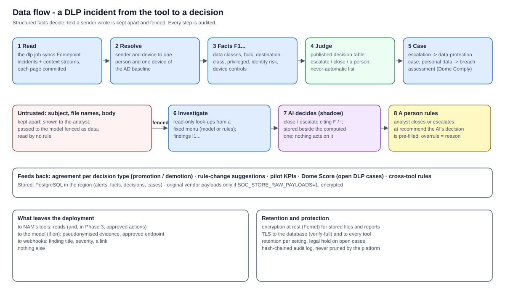

# 3. Data flow and protection

| | |
|---|---|
| **Document** | CyberDome for NAM - review pack, document 3 of 9 |
| **Answers** | What data is collected from NAM's tools, how it is processed and stored, personal data, retention and deletion, encryption, residency, and every transfer outside the deployment |

## 3.1 Residency

| Principle | How | Status |
|---|---|---|
| Data stays in India | the platform, its database, backups and stored files run in NAM's environment or an Indian cloud region | Configured at deployment |
| The model stays in India, or is off | the only model endpoint allowed is the approved one (NAM's gateway or an Indian-region model); `SOC_LLM_PROVIDER=none` is a complete configuration | Implemented; Configured at deployment |
| Raw vendor logs stay in the region | original vendor payloads are not kept by default; if NAM enables it they are encrypted in the same database | Implemented |

## 3.2 Data collected

| Source | Data | Personal data | Kept as |
|---|---|---|---|
| AD / CMDB export | devices (name, serial, OS, last seen); people (UPN, display name, department, groups) | names, work identifiers | entities (device, person) |
| Forcepoint DLP | incidents: time, severity, channel, the tool's action, policy and rule, classifier names, match counts and types, destination, sender account and device, **subject and file names**, status and resolution; agent check-ins; health; rule configuration | the sender; data classes (e.g. "PAN", "Aadhaar") as **labels and counts, not the matched values** - the platform never receives the leaked data itself; subject and file names may contain personal text | DLP alerts (facts), events, untrusted text kept apart |
| Silverfort | risky authentications: person, time, risk level, factors | work identity, sign-in metadata | events (`auth_risk`) |
| Trend Micro | agents (device, last check-in); detections (device, user, time, title, severity) | user names on detections | entities, events (`edr_alert`) |
| Trellix ePO | devices and encryption state; health; policies | none beyond device names | entities, health, snapshots |
| NAM's SIEM | alerts NAM chooses to push (title, severity, host, user, indicators) | as pushed | events |
| People using CyberDome | sign-in identity, actions, notes, rulings, decisions | work identity | audit log, access log, cases |

## 3.3 How it is processed

1. **Read** by the scheduled jobs (or a person's *Pull*), page by page, each page committed.
2. **Normalised** to one schema and **resolved** to one person and one device across tools (deterministic keys
   first; uncertain matches wait for an analyst, never merged by guess).
3. **Facts** are built for each DLP alert (numbered F1, F2 ...); text the sender wrote is kept apart as untrusted.
4. **Judged** by the published decision table; cases opened; personal-data cases open a breach assessment.
5. **Investigated** with read-only look-ups over what the platform holds; **the AI's decision** stored beside the
   computed one (shadow).
6. **People** rule, approve, decide reportability; everything audited.

## 3.4 Where it is stored

| Store | Contents | Protection |
|---|---|---|
| PostgreSQL | everything durable: entities, events, alerts, facts, cases, decisions, documents (policy, weights, catalogue), job runs, the audit chain | TLS (verify-full); a runtime role without schema rights and append-only access to the audit log; encrypted storage; HA and backups in region |
| Stored files (in PostgreSQL, `blobs`) | reports, audit packs, report-style files, original payloads if enabled | Fernet encryption with `SOC_DATA_KEY` (rotatable, mandatory in production) and a SHA-256 of the plaintext: a row changed outside the platform is refused on read |
| Logs (stdout) | one structured line per request, audit event, model call, outbound call, job | secrets masked, no query strings or bodies; shipped to NAM's log platform |

## 3.5 Retention and deletion

| Data | Default | Setting |
|---|---|---|
| Original vendor payloads (off by default) | 180 days | `SOC_RAW_RETENTION_DAYS` |
| Telemetry events (and their keys, relations, source records) | 400 days, unless a case or finding cites them | `SOC_EVENT_RETENTION_DAYS` |
| Access log | 400 days | `SOC_ACCESS_LOG_RETENTION_DAYS` |
| Model prompts and answers (text) | 180 days (the figures are kept) | `SOC_LLM_LOG_RETENTION_DAYS` |
| Cases, decisions, audit log | not pruned by the platform | legal hold applies to open cases |

Retention runs daily, is audited, and respects legal hold on open cases. NAM's own retention rules (including
CERT-In's expectation of 180 days of logs, which Dome Comply checks per tool) are set at deployment.

## 3.6 Encryption

| Where | How | Status |
|---|---|---|
| Browser ↔ platform | TLS 1.2+ at the ingress; HSTS | Configured at deployment |
| Platform ↔ database | TLS, server certificate verified (production refuses anything else) | Implemented |
| Platform ↔ NAM's tools and the model | HTTPS; an internal CA bundle supported | Implemented |
| At rest | stored files Fernet-encrypted; database on encrypted storage | Implemented; storage Configured at deployment |
| Secrets | vault-mounted files; never in configuration or code | Implemented |

## 3.7 Every transfer outside the deployment

| Destination | What is sent | When | Control |
|---|---|---|---|
| NAM's tools | API requests (reads; approved actions from Phase 3) | always (per tool, once past fake mode) | per-tool accounts; least privilege |
| The model endpoint | the item's numbered evidence, **pseudonymised** (users, names, internal hosts, internal IPs, phone, card and national ids replaced by tokens); untrusted text fenced | only if the model is on | approved endpoint only, in NAM's environment or an Indian region; budgets |
| Notification webhooks | a finding's title, severity and a link | only if configured | https only; URLs stored as secrets, never shown |
| Entra ID | sign-in key requests | production | - |

Nothing else leaves: no public intelligence feed is called in NAM's scope, no URL from a message is fetched, and the
platform sends no telemetry anywhere.

## 3.8 Personal data under DPDP

| Topic | Position | Status |
|---|---|---|
| Purpose | security monitoring and incident response for NAM | - |
| Minimisation | the platform receives labels and counts of personal-data classes, not the values; original payloads off by default | Implemented |
| Pseudonymisation before the model | always on (`SOC_LLM_REDACT_PII=1`) | Implemented |
| Access | by role and data scope; DLP data only within `dlp` scope or all domains; out-of-scope records answer "not found" | Implemented |
| A personal-data incident | opens a breach assessment; a person decides reportability; clocks from the catalogue (to verify) | Implemented |
| Data-subject requests | personal data is in the context store and cases; deletion follows retention or a scripted request | To agree with NAM |
