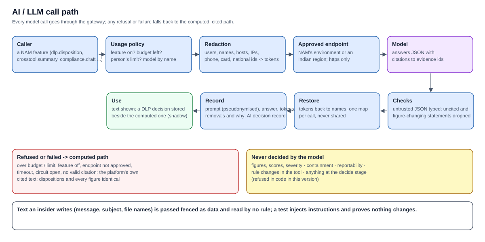

# 4. AI / LLM security

| | |
|---|---|
| **Document** | CyberDome for NAM - review pack, document 4 of 9 |
| **Answers** | Where the model runs; what it sees; what it may and may not decide; how its authority is earned and taken back; the safeguards; cost and abuse controls |

## 4.1 Hosting

| Item | Position | Status |
|---|---|---|
| Where | NAM's own LLM gateway, or a model in an Indian cloud region; nothing else | Configured at deployment |
| Which models | to be decided with NAM from what that region offers; chosen per feature by name, version-pinned | Configured at deployment |
| Off | `SOC_LLM_PROVIDER=none`: every module runs on its computed path with identical figures and computed outcomes | Implemented |
| Allow-list | `SOC_LLM_APPROVED_ENDPOINTS`, mandatory and https-only in production; any other endpoint refused | Implemented |

## 4.2 What the model is used for

| Feature | What the model does | Without it |
|---|---|---|
| DLP disposition | its own close / escalate decision on an alert, citing the facts; **stored beside the computed one** | no AI decision; the computed disposition |
| DLP investigation | chooses up to 5 read-only look-ups in 2 rounds from a fixed menu of 7 | the platform's standard checks |
| Cross-tool case account | a written account from the tools' cited facts | written by rule |
| The Dome Score in plain words | explains the computed factors, on request | written by rule |
| Breach-report draft | drafts from the case's structured facts, every sentence cited, on a lead's request | the facts by rule |
| Incident summaries, analyst Q&A, report commentary, tuning drafts | narrative and planning over computed figures | deterministic text |

## 4.3 What the model never decides

* Any figure, score, coverage or severity.
* Containment (isolating a device, disabling an account, rotating a privileged credential) - two people, always.
* Reportability under DPDP / CERT-In - a person.
* A rule change in Forcepoint - proposed, approved by a second lead, made by an engineer.
* Anything at the *decide* stage - refused in code in this version.

## 4.4 The earned-autonomy ladder

| Step | Rule | Status |
|---|---|---|
| Narrow decision types | `dlp.email`, `dlp.web`, `dlp.removable_media`, `dlp.other` - each climbs on its own | Implemented |
| Shadow (start) | the AI decides beside the analyst; nothing happens; agreement is measured | Implemented |
| Recommend | the AI's decision is pre-filled; overruling it needs a reason | Implemented |
| Decide | refused in code; before it is enabled anywhere, an adversarial DLP-content test set must exist and pass | Not built (Phase 3) |
| Target | agreement % and minimum sample set by NAM's SOC lead per type; **no default** | Implemented; Configured by NAM |
| Promotion | proposed by a lead, refused unless measured agreement meets the target, approved by a **second lead**, measured again at approval | Implemented |
| Demotion | automatic when agreement falls below target or the AI's outcome mix shifts (PSI > 0.25); a lead may demote alone | Implemented |

## 4.5 Safeguards (each with a test that fails when removed)

| Safeguard | How |
|---|---|
| Never closed automatically | high / critical alerts, privileged users, deception hits, devices with a known-exploited flaw, the block watch list |
| Close only on agreement | the AI may escalate alone; it may close only where the computed disposition agrees; disagreement goes to a person |
| Insider text is data | message body, subject and file names are passed fenced as untrusted data; no rule reads them; no decision lowers severity on content; a test injects instructions and proves nothing changes |
| Citations or nothing | a decision or statement without a valid citation is discarded; a statement stating a figure absent from its evidence is dropped |
| Untrusted output | model JSON is type-checked field by field; malformed items dropped and counted |
| Full record | every AI decision stores model and version, prompt version, evidence hash, structured output and stage; every call logs the pseudonymised prompt, answer, tokens and what the checks removed and why |
| Re-checks | 1 in 10 AI closures re-checked by a person, permanently |
| Identical without the model | figures and computed outcomes are the same with the model on or off (a test) |

## 4.6 What the model sees

The item's numbered evidence - facts (F#), investigation findings (I#), posture factors (P#) - with identities
**pseudonymised** before the prompt leaves (internal users and names, internal host names and addresses, phone, card
and national ids) and restored after, one map per call. Untrusted text appears only inside a fence. The model never
receives a secret, a mailbox, a file's content or a whole log.

## 4.7 Access restrictions

| Who | May |
|---|---|
| Scheduled jobs | the scheduled features (`dlp.disposition`, `dlp.investigate`, `crosstool.summary`, ...) within the budgets |
| A person | the person-triggered features (explain, draft, Q&A, report planning) within their own hourly / daily limit |
| Administrators (MFA) | set budgets, per-person limits, per-feature model, answer cap, on / off - versioned and audited |

## 4.8 Cost and abuse controls

| Control | Default |
|---|---|
| Monthly / daily token budget | 50 M / a tenth of the month; findings at 80 % and 100 % |
| Per-person limit | 100 k / hour, 400 k / day; overrides per role and person; 0 = no model text |
| Answer cap per feature | small 1,500 / large 3,000 tokens |
| DLP alerts the model handles per run | 200 (`SOC_DLP_AI_MAX_PER_RUN`) |
| Investigation budget per alert | 20 s |
| Circuit breaker | after 3 failures the model is skipped for 60 s |

Over any limit nothing fails: the call is not sent and the computed path answers. Cost per alert for NAM is **not
estimated in advance**: Phase 1 measures alert volume, the share reaching the model and tokens per alert, and the
pilot scorecard shows the model's share and cost per alert weekly.
