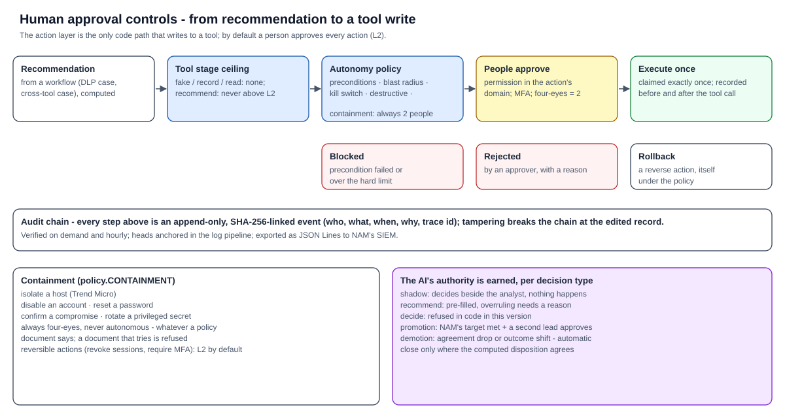

# 5. Security risk and governance

| | |
|---|---|
| **Document** | CyberDome for NAM - review pack, document 5 of 9 |
| **Answers** | The risk assessment; access control; audit logging; monitoring; human approval controls; the security testing performed |

## 5.1 Risk assessment

| # | Risk | Likelihood before controls | Controls | Residual |
|---|---|---|---|---|
| R1 | An insider writes text to talk the AI or an analyst into closing a DLP alert | Medium | facts not text; text fenced; no rule reads it; destination kept only as a real host name | Low |
| R2 | The AI closes real data loss | Medium | shadow first; promotion on NAM's target and a second lead; close only on agreement with the computed disposition; never-automatic list; 1 in 10 re-checked; automatic demotion | Low |
| R3 | Containment run by the platform or by one person | Medium | engine-enforced four-eyes for containment whatever the policy says | Low |
| R4 | A stolen session used to decide | Medium | Entra ID, MFA for every decision, revocation, short sessions | Low |
| R5 | Over-privileged integration accounts | Medium | read-only accounts per tool; writes only from Phase 3, per action | Low (Configured at deployment) |
| R6 | Personal data leaving India through the model | Medium | model in NAM's environment or an Indian region, or off; pseudonymisation; approved endpoints | Low |
| R7 | Tampered evidence or history | Low | hash-chained append-only audit; database refuses edits; hourly verification; anchors in NAM's log platform | Low |
| R8 | A governance document changed quietly (weights, catalogue, policy) | Medium | versioned; two people; exactly-once approvals; every step audited | Low |
| R9 | A regulatory deadline restarted or decided by the platform | Medium | a person decides; the decision stands; strict boolean; exactly-once | Low |
| R10 | A DLP rule change hides real data loss | Medium | refused when it would hide escalated / bulk personal / high or critical / never-automatic alerts; second lead; engineer; verified | Low |
| R11 | A tool outage misread as safety | Medium | "not measured" / "not reported" instead of zero or healthy; freshness per stream; stale shown | Low |
| R12 | NAM's tool APIs differ from the placeholders | High | fake mode until confirmed; every path a setting; preflight; record and sanitise | Medium until each tool is onboarded |
| R13 | Availability loss | Medium | stateless replicas, database HA, leased jobs, 503 not 500 under saturation | Low |

## 5.2 Access control

| Role | May |
|---|---|
| Analyst | investigate, rule on DLP alerts, take cases, add notes, request and approve normal actions, log outages |
| Lead | everything an analyst may, plus approve high-impact and four-eyes actions, propose / approve weights, catalogue, rule changes, decision-type targets and promotions, decide reportability, export evidence |
| Admin | access management (grants, API keys), connectors, kill switch, AI usage policy |
| Automation admin | connectors, jobs, propose the autonomy policy, record tool changes |
| Auditor | read everything in scope, the audit log, evidence exports |

* **Data scope:** `dlp`, `incident` or all domains; the Dome Score, Dome Comply and Pilot screens need all domains;
  out-of-scope records answer "not found"; each role acts only inside its own scope.
* **Step-up MFA** for every decision; **separation of duties** everywhere (nobody approves their own proposal,
  compared case-insensitively); service accounts never approve, change policy or manage access; privileged grants
  need a second administrator and end within 90 days.
* **Break-glass:** a sealed secret exchanged once for a 15-minute session, audited and alerted.

## 5.3 Audit logging

| Record | Contents | Protection |
|---|---|---|
| Audit chain | every change and decision by a person or the AI: rulings, AI decisions, approvals, actions, documents, access, exports; every successful write request leaves at least one event | append-only (application and database), SHA-256 linked, verified hourly, anchors shipped to NAM's log platform, never pruned by the platform |
| Access log | every API request: who, what, status, latency, address | append-only; 400 days |
| Model calls | prompt (pseudonymised), answer, tokens, removals and why | 180 days of text |
| Trace | one id ties a request or job to every record it caused | - |

Exports: JSON Lines, JSON, CSV (formula-guarded), Excel, Word; each export audited; an unfiltered export re-verifies
outside the platform. The Dome Comply audit pack bundles the controls, assessments, the catalogue and the full trail.

## 5.4 Monitoring

`/health` (scheduler state, audit chain), `/health/live` and `/health/ready` for probes, `/metrics` (Prometheus:
cases, actions, sync age, kill switch, scheduler heartbeat, audit chain, failing jobs, break-glass use), alert rules
for the Kubernetes package, the hourly self-check, structured JSON logs. Recommended alerts: scheduler stopped, audit
chain broken, any break-glass use, an action outcome unknown, a job failing for 30 minutes, a tool stale for 6 hours.

## 5.5 Human approval controls

| Control | Status |
|---|---|
| Default L2 for every action: the platform recommends, a person decides | Implemented |
| A tool at `recommend` caps its actions at L2 whatever the policy says | Implemented |
| Containment always four-eyes, never autonomous (engine-enforced) | Implemented |
| Destructive actions never autonomous; VIP / critical targets and blast radius force approval; hard limits block | Implemented |
| Exactly-once approval; recorded before and after the tool call; an unknown outcome flagged, never re-run | Implemented |
| Kill switch: durable, every replica, immediate | Implemented |
| Two leads for weights, catalogue, rule changes, promotions; a lead in person for reportability | Implemented |

## 5.6 Security testing performed

| Test | Result |
|---|---|
| Penetration test of the NAM surface (round 39): every NAM route with every role, a lead without MFA, a lead of another domain, a service key, anonymous; hostile values; racing decisions; sender text; manual vs scheduled runs | 6 findings fixed (2 high: racing approvals, containment could be made autonomous; 2 medium; 2 low); 8 permanent tests |
| The inherited attack suite (24 tests): authentication bypass, token forgery, privilege escalation, cross-domain access, injection, path traversal, upload abuse, leakage, CORS, brute force, races | passes on every build |
| Every GET route × 7 roles; write-route fuzzing | passes on every build |
| Browser tour with a stored-XSS probe through every field a person writes (NAM scope) | no XSS; strict CSP |
| Static analysis (bandit), dependency audit (pip-audit), image scan (Trivy), secret scan | clean gates in CI |
| Independent penetration test of the deployed platform | planned before NAM's data (scope in `docs/SECURITY.md`) |
