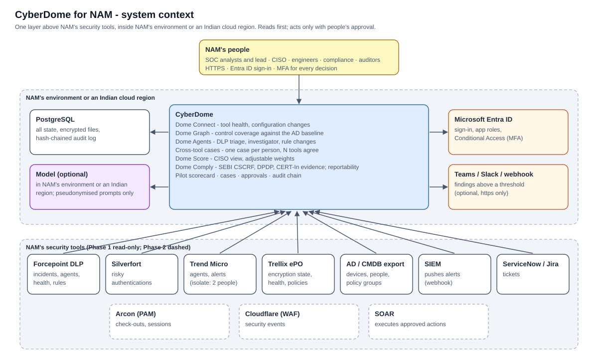
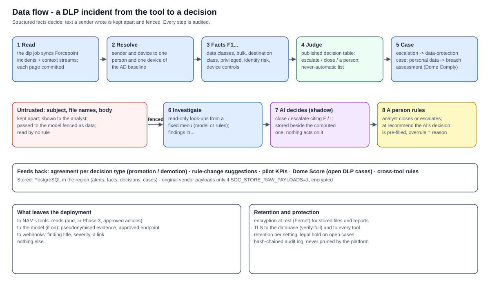
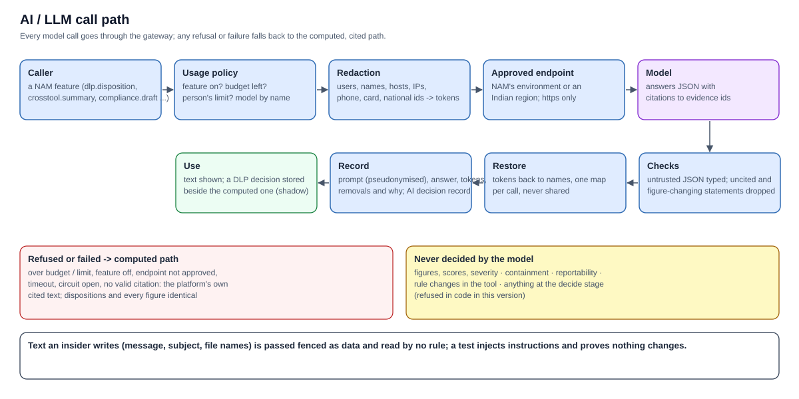
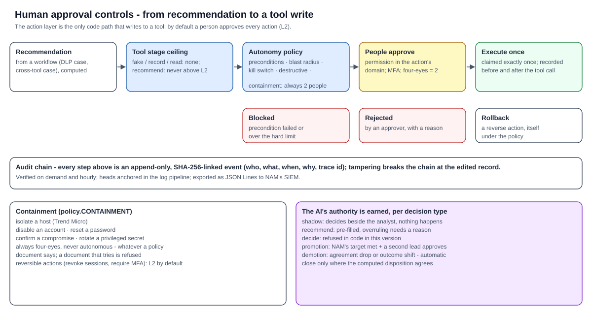

# 8. Architecture and data flow overview

| | |
|---|---|
| **Document** | CyberDome for NAM - review pack, document 8 of 9 (for the customer presentation) |
| **Answers** | The architecture, data flow, AI components, human control and external transfers - in one view each |

## 8.1 One layer, inside NAM's boundary

CyberDome runs in NAM's environment or an Indian cloud region. It reads Forcepoint DLP, Silverfort, Trend Micro,
Trellix ePO and the AD / CMDB export (Arcon, Cloudflare and NAM's SIEM / SOAR follow in Phase 2), resolves every
record to one device or person, and offers the CyberDome modules: Dome Connect, Dome Graph, Dome Agents, cross-tool
cases, the Dome Score, Dome Comply and the pilot scorecard. In Phases 1-2 nothing is written to any tool.

## 8.2 Data flow

A DLP incident is read, resolved to its sender and device, turned into numbered facts, judged by a published table,
escalated into a case when warranted, investigated with read-only look-ups, decided by the AI in shadow, and ruled on
by an analyst. Text the sender wrote is kept apart and never decides. Everything is stored in PostgreSQL in the region.

## 8.3 The AI

Optional, in NAM's environment or an Indian region. Every call passes the usage policy, pseudonymisation and the
approved-endpoint check; the answer passes the citation and numeric checks; any refusal or failure falls back to the
computed path. The AI's authority over DLP dispositions is earned per decision type.

## 8.4 Human control

Every action is recommended; a person approves; containment needs two people whatever the policy says. Weights,
catalogue, rule changes and AI promotions need two leads. Reportability is a person's decision.

## 8.5 External transfers

| To | What | When |
|---|---|---|
| NAM's tools | API reads; approved actions from Phase 3 | always |
| The model | pseudonymised evidence | only if on; approved endpoint in NAM's environment or an Indian region |
| Teams / Slack / webhook | a finding's title, severity, link | only if configured |
| Entra ID | sign-in key requests | production |

Nothing else leaves the deployment.
